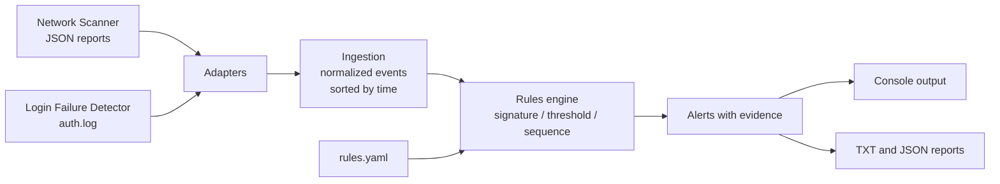

# Mini-SIEM

[](https://github.com/LeanGnzlz/Mini-SIEM/actions/workflows/tests.yml)

Educational Python tool that collects security events from different sources, normalizes them into a common format, correlates them with configurable detection rules and generates alerts with their supporting evidence.

It is built on top of my two previous projects, which act as data sources:

- [Network Scanner](https://github.com/LeanGnzlz/network-scanner-python): TCP port scanning.
- [Login Failure Detector](https://github.com/LeanGnzlz/Login-Failure-Detector): authentication log analysis.

## Goal

Understand and apply the core concepts of a SIEM (Security Information and Event Management), the tool a SOC uses to monitor and detect suspicious activity:

- Log ingestion from multiple sources
- Normalization into a single event schema
- Event correlation over time
- Alert generation with severity and MITRE ATT&CK mapping
- Reports with the evidence behind each detection

## Features

- Ingests Network Scanner JSON reports and Login Failure Detector authentication logs
- Common event model, with all timestamps converted to UTC
- Detection rules configurable in YAML, no code changes needed
- Three rule types: signature, threshold (sliding window, with distinct-value counting) and sequence
- One alert per episode, to avoid flooding the analyst with noise
- Every rule mapped to a MITRE ATT&CK technique
- TXT and JSON reports with the evidence events of each alert
- Strict validation of data and rules: nothing is silently discarded
- Over 280 automated tests with pytest

## How it works



1. **Adapters:** each source has a translator that converts its data to the common format. Invalid lines are rejected and reported, never silently lost.
2. **Ingestion:** merges the events from all sources into a single timeline sorted by time.
3. **Rules engine:** loads the rules from the YAML file, validates them and applies them to the events.
4. **Alerts:** each detection produces an alert with its severity, its MITRE technique and the identifiers of the events that triggered it.
5. **Output:** alerts are printed to the console and, when requested, saved to a TXT and a JSON report with the full evidence.

### Rule types

| Type | What it detects | Included example |
|---|---|---|
| Signature | A single event that is suspicious on its own | Remote access port open |
| Threshold | N events, or N distinct values, within a time window, grouped by an entity | Brute force and password spraying |
| Sequence | Several events in a given order within a window | Failed logins followed by a successful login |


## Installation

Developed and tested with Python 3.13.

```bash
git clone https://github.com/LeanGnzlz/Mini-SIEM.git
cd Mini-SIEM
python -m venv venv
```

Activate the virtual environment:

- Windows (PowerShell): `.\venv\Scripts\Activate.ps1`
- Linux / macOS: `source venv/bin/activate`

Install the dependencies:

```bash
python -m pip install -r requirements.txt
```

## Usage

The repository includes sample input files, so you can try it right away:

```bash
python mini_siem.py --scan examples/scan_report.json --auth-log examples/auth.log
```

Save the reports to a folder:

```bash
python mini_siem.py --scan examples/scan_report.json --auth-log examples/auth.log --report-dir reports
```

### Options

| Option | Description |
|---|---|
| `--scan FILE [FILE ...]` | Network Scanner JSON report(s) |
| `--auth-log FILE [FILE ...]` | Authentication log file(s) |
| `--rules FILE` | Detection rules file (default: `rules/rules.yaml`) |
| `--report-dir DIR` | Write a JSON and a TXT report to this folder |

At least one of `--scan` or `--auth-log` is required.

### Exit codes

| Code | Meaning |
|---|---|
| `0` | The run finished. Finding alerts is not an error. |
| `2` | Error: invalid rules, unreadable input, report could not be written, or wrong usage |

Input lines that cannot be parsed are reported as warnings on `stderr` and counted in the summary, and the rest of the data is still processed.

## Example output

```text
Mini-SIEM
Events ingested: 14
Rejected inputs: 0
Rules loaded: 4 (4 enabled)
Alerts: 4 (high: 1, medium: 3)

[HIGH] R001 Sensitive port open
  Time: 2026-06-25 16:58:39 UTC
  Remote access or file sharing port found open
  Evidence: 1 event(s)

[MEDIUM] R002 Brute force (T1110.001)
  Time: 2026-06-26 13:01:25 UTC
  Repeated failed logins from one IP: src_ip=185.23.44.10, 5 events within 300s
  Evidence: 5 event(s)

[MEDIUM] R002 Brute force (T1110.001)
  Time: 2026-06-26 14:00:09 UTC
  Repeated failed logins from one IP: src_ip=10.0.0.50, 5 events within 300s
  Evidence: 5 event(s)

[MEDIUM] R004 Password spraying (T1110.003)
  Time: 2026-06-26 14:00:09 UTC
  Failed logins against several different users from one IP: src_ip=10.0.0.50, 5 distinct user values within 300s
  Evidence: 5 event(s)
```

The input files store timestamps without a time zone. They are interpreted as the local time of the machine running the tool and converted to UTC, so the exact times shown depend on where it runs. The example above was generated at UTC-3.

## Reports

With `--report-dir`, each run writes two files with the same name, `siem_report_YYYYMMDD_HHMMSS.json` and `.txt`. An existing report is never overwritten.

- The **TXT** report is meant to be read by a person: summary, alerts and one line per evidence event.
- The **JSON** report is meant for other tools: the same data, plus the full original log line of every evidence event.

Excerpt from the TXT report:

```text
[HIGH] R001 Sensitive port open
  Time: 2026-06-25 16:58:39 UTC
  Remote access or file sharing port found open
  Evidence (1 event(s)):
    - 2026-06-25 16:58:39 UTC | port_open | network_scanner | dest 127.0.0.1:445
```

Reports can contain real usernames, IP addresses and log lines. The contents of `data/` and `reports/` are ignored by Git, so put your own logs in `data/` and write reports to `reports/` to avoid publishing them by accident.


## Detection rules

Rules live in `rules/rules.yaml`. Editing that file is enough to tune a threshold, disable a rule or add a new one, with no code changes.

### Included rules

| ID | Name | Type | Severity | MITRE ATT&CK |
|---|---|---|---|---|
| R001 | Sensitive port open | Signature | high | none |
| R002 | Brute force | Threshold | medium | T1110.001 (Password Guessing) |
| R003 | Successful brute force | Sequence | high | T1110 (Brute Force) |
| R004 | Password spraying | Threshold | medium | T1110.003 (Password Spraying) |

- **R001** flags ports 23, 445, 3389 and 5900 (Telnet, SMB, RDP and VNC) found open. It has no MITRE technique on purpose: an open port is an exposure, not an observed attacker technique, and forcing a mapping would be misleading.
- **R002** fires on 5 failed logins from the same IP within 300 seconds.
- **R003** fires on 5 failed logins followed by a successful login from the same IP within 300 seconds, which suggests the attacker may have gotten in.
- **R004** fires on failed logins against 5 distinct users from the same IP within 300 seconds.

### Rule format

```yaml
rules:
  - id: R003
    name: Successful brute force
    type: sequence
    severity: high
    mitre: T1110
    description: Failed logins followed by a successful login from the same IP
    group_by: src_ip
    window_seconds: 300
    steps:
      - event_type: auth_failure
        count: 5
      - event_type: auth_success
```

Fields common to every rule:

| Field | Required | Description |
|---|---|---|
| `id` | yes | Unique identifier |
| `name` | yes | Short name shown in alerts |
| `type` | yes | `signature`, `threshold` or `sequence` |
| `severity` | yes | `low`, `medium`, `high` or `critical` |
| `description` | no | Text shown in the alert |
| `mitre` | no | MITRE ATT&CK technique id, such as `T1110` or `T1110.001` |
| `enabled` | no | `false` loads the rule but skips it (default `true`) |

Fields specific to each type:

| Type | Fields |
|---|---|
| Signature | `event_type` (required), `dest_ports` (optional list, empty means any port) |
| Threshold | `event_type`, `group_by`, `window_seconds`, `threshold` (all required), `distinct` (optional) |
| Sequence | `group_by`, `window_seconds`, `steps` (all required, at least 2 steps; each step has an `event_type` and an optional `count`) |

Valid event types are `auth_failure`, `auth_success` and `port_open`. `group_by` accepts `src_ip`, `dest_ip` or `user`. With `distinct`, a threshold rule counts distinct values of that field instead of events, which is how password spraying (many users from one IP) is told apart from plain brute force.

### How rules are evaluated

- Events are grouped by the entity in `group_by` (for example, one counter per source IP), and events without that field are ignored.
- Time windows are sliding and inclusive: events exactly `window_seconds` apart still count together.
- A threshold rule raises one alert when the count reaches the threshold, and stays quiet while the activity continues. It can alert again only after the count drops back below the threshold, so a sustained attack produces one alert and two separate bursts produce two.
- A sequence rule matches its steps in order and ignores unrelated events in between. After it fires, the window of that group is cleared, so a second successful login right after does not alert again.
- The same event can trigger several rules. Each alert lists the identifiers of its evidence events.

### Rule validation

The rules file is validated strictly and loaded all or nothing, because a rule that is silently wrong is a blind spot in detection:

- Unknown fields are rejected, which catches typos such as `windows_seconds`.
- Fields that do not apply to the rule type are rejected.
- Event types are checked against the known list, so `auth_faliure` is an error instead of a rule that never fires.
- Numbers must be real positive integers. YAML values such as `yes` or `true` are not accepted where a number is expected.
- Duplicate rule ids are rejected, and errors name the position of the offending rule.
- The file is read with `yaml.safe_load`, which never builds arbitrary Python objects.

## Project structure

```text
Mini-SIEM/
├── mini_siem.py            command line interface
├── requirements.txt
├── adapters/
│   ├── network_scanner_adapter.py
│   └── login_detector_adapter.py
├── engine/
│   ├── event.py            event model
│   ├── alert.py            alert model
│   ├── rule.py             rule model and YAML loading
│   ├── evaluator.py        signature, threshold and sequence evaluators
│   ├── ingest.py           merges all sources into one timeline
│   └── report.py           TXT and JSON reports
├── rules/
│   └── rules.yaml          detection rules
├── examples/               sample input files
├── data/                   your own logs (ignored by Git)
├── reports/                generated reports (ignored by Git)
├── storage/                reserved for persistence, empty for now
└── tests/
```

## Running the tests

```bash
python -m pytest
```

The suite covers each module on its own (models, adapters, every rule type, reports, command line), the edges of the time windows, the shipped `rules.yaml`, and complete runs from input files to alerts. Tests write only to temporary folders, so they never touch `data/` or `reports/`.


## Known limitations

- **Timestamps without a time zone.** Neither the Network Scanner reports nor the authentication logs record a time zone, so the adapters read them as the local time of the machine running the tool. Analyzing logs from a server in another time zone produces shifted times.
- **Scan time.** The scanner only stores when a scan finished, so every open port from one report gets that time, not the moment it was found.
- **One grouping field.** A rule groups by a single field. The brute force rule counts failures per source IP, so a password spraying attempt (5 different users from one IP) also triggers it. The example output shows this for `10.0.0.50`: R002 and R004 both fire on the same 5 events. Grouping by IP and user at the same time is planned.
- **Sequences are matched by IP and time only.** A successful login in the middle of the failures does not restart a sequence, and failures followed by a success from a shared IP (for example, behind NAT) are treated as one episode.
- **Batch analysis only.** The tool reads files. It does not collect events live and keeps no history between runs, so running it twice on the same data produces the same alerts again.
- **All or nothing for scan reports.** A scan report with one invalid entry is rejected as a whole, while an authentication log is judged line by line.
- **Two input formats.** Only the output of the two companion projects is supported.

Two of these behaviors (grouping by source IP only and sequences that are not reset) are pinned down by tests, so changing them will be a deliberate decision.

## Future work

- Persist events and alerts in SQLite to query history across runs
- Group rules by more than one field, such as IP and user
- Optional reset condition for sequence rules
- Support real log formats: Linux sshd authentication logs and Windows failed logon events (4625)
- Simple dashboard to browse alerts
- Automated response (SOAR-style playbooks) as a separate follow-up project

## Disclaimer

Mini-SIEM is an educational project and not a replacement for a production SIEM. Use it only with data you own or are explicitly authorized to analyze. Logs and reports can contain personal and sensitive information, so handle them accordingly and never publish them.