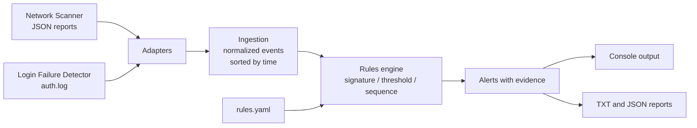

# Mini-SIEM

Educational Python tool that collects security events from different sources, normalizes them into a common format, correlates them with configurable detection rules and generates alerts with their supporting evidence.

It is built on top of my two previous projects, which act as data sources:

- [Network Scanner](https://github.com/LeanGnzlz/network-scanner-python): TCP port scanning.
- [Login Failure Detector](https://github.com/LeanGnzlz/Login-Failure-Detector): authentication log analysis.

## Goal

Understand and apply the core concepts of a SIEM (Security Information and Event Management), the tool a SOC uses to monitor and detect suspicious activity:

- Log ingestion from multiple sources
- Normalization into a single event schema
- Event correlation over time
- Alert generation with severity and MITRE ATT&CK mapping
- Reports with the evidence behind each detection

## Features

- Ingests Network Scanner JSON reports and Login Failure Detector authentication logs
- Common event model, with all timestamps converted to UTC
- Detection rules configurable in YAML, no code changes needed
- Three rule types: signature, threshold (sliding window, with distinct-value counting) and sequence
- One alert per episode, to avoid flooding the analyst with noise
- Every rule mapped to a MITRE ATT&CK technique
- TXT and JSON reports with the evidence events of each alert
- Strict validation of data and rules: nothing is silently discarded
- Over 280 automated tests with pytest

## How it works

1. **Adapters:** each source has a translator that converts its data to the common format. Invalid lines are rejected and reported, never silently lost.
2. **Ingestion:** merges the events from all sources into a single timeline sorted by time.
3. **Rules engine:** loads the rules from the YAML file, validates them and applies them to the events.
4. **Alerts:** each detection produces an alert with its severity, its MITRE technique and the identifiers of the events that triggered it.
5. **Output:** alerts are printed to the console and, when requested, saved to a TXT and a JSON report with the full evidence.

### Rule types

| Type | What it detects | Included example |
|---|---|---|
| Signature | A single event that is suspicious on its own | Remote access port open |
| Threshold | N events, or N distinct values, within a time window, grouped by an entity | Brute force and password spraying |
| Sequence | Several events in a given order within a window | Failed logins followed by a successful login |